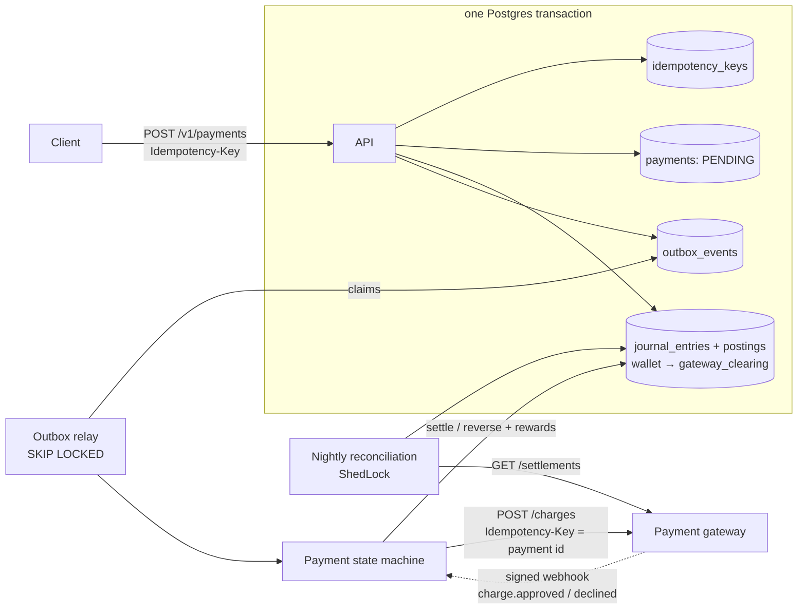
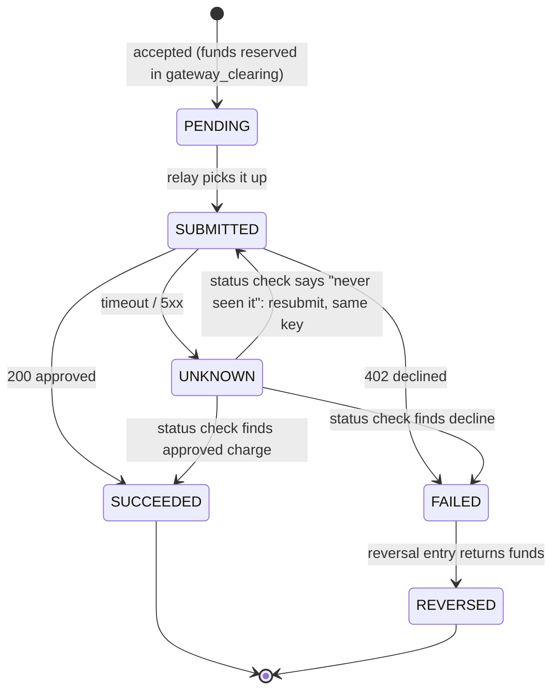
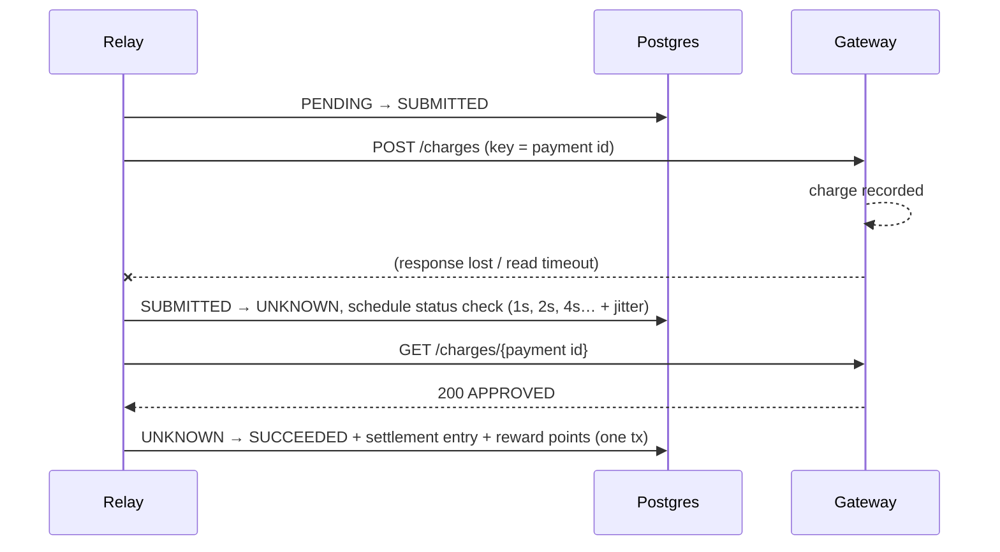

# Ledgerline

A REST API for paying bills from a wallet and earning reward points, built so that **no payment is ever charged twice**: not when clients retry, not when requests race, not when the payment gateway times out.

Java 21 · Spring Boot 3.3 · PostgreSQL 16 · Flyway · JdbcClient · ShedLock · Micrometer/Prometheus · JUnit 5 · jqwik · Testcontainers

## What it guarantees, and how

| Threat | Mechanism |
|---|---|
| Client retries the same request | **Idempotency keys**: the key row, the work and the stored response commit in one transaction; a repeat replays the original bytes (`Idempotent-Replayed: true`), a repeat with a different body gets 422, a repeat while the first is still running gets 409 + `Retry-After` |
| Two different requests spend the same balance | **Row-level locking**: `SELECT … FOR UPDATE` on every account with a balance rule (wallets, points) an entry touches, always in account-id order (no deadlocks) |
| Crash between "money moved" and "tell the gateway" | **Transactional outbox**: ledger entry and gateway event commit together; a relay (`FOR UPDATE SKIP LOCKED`) delivers at-least-once |
| Gateway times out: did it charge or not? | **Payment state machine**: a timeout means UNKNOWN, never FAILED. We ask the gateway (status checks with exponential backoff + jitter), resubmit only on a confirmed "not found", and always send our payment id as the gateway's idempotency key |
| Gateway pushes the outcome (webhooks) | **Signed, deduplicated webhooks**: HMAC-SHA256 over timestamp + raw body, constant-time compare, 5-minute replay window; the gateway's event id is recorded in the same transaction as the transition it causes, after locking the payment row, so redeliveries and races with the relay or status checks apply once |
| Anything we missed | **Nightly reconciliation** against the gateway's settlement report, plus ledger self-checks |
| Bugs in our own code | **Double-entry ledger** enforced by the database: a deferred trigger rejects any journal entry that doesn't sum to zero per currency, and ledger tables are append-only |

## Architecture



The request path only writes to Postgres. Everything that talks to the gateway happens afterwards and is safe to repeat.

### The payment state machine



Every transition is a compare-and-set on `(status, version)`, so of two writers racing the same transition exactly one wins. Settlement, reversal and reward accrual are posted in the same transaction as the transition, and `UNIQUE (type, reference_id)` on journal entries means a duplicate can't post twice even if everything else failed. A payment still UNKNOWN after the last status check is **not** reversed (it may have been charged); it waits for reconciliation.

### The timeout case, step by step



## Ledger model

Postings are signed minor units (debit = positive, credit = negative), so every balanced entry sums to 0. Points are just another currency (`PTS`) in the same ledger.

| Event | Debit | Credit |
|---|---|---|
| Top-up | `cash_bank:INR` | `user_wallet:{wallet}` |
| Payment accepted | `user_wallet:{wallet}` | `gateway_clearing:INR` |
| Gateway approved | `gateway_clearing:INR` | `biller_payable:{biller}` |
| Gateway declined | `gateway_clearing:INR` | `user_wallet:{wallet}` |
| Points accrued | `rewards_expense:PTS` | `rewards_points:{user}` |
| Points redeemed | `rewards_points:{user}` (PTS) + `rewards_funding:INR` | `rewards_redeemed:PTS` + `user_wallet:{wallet}` |
| Refund confirmed | `biller_payable:{biller}` | `user_wallet:{wallet}` |
| Points clawed back | `rewards_points:{user}` | `rewards_expense:PTS` |

Accounts with a balance rule (user wallets and points) keep a cached `accounts.balance`, updated under their row lock in the same transaction. House accounts (cash, clearing, biller payables, rewards) have no rule to protect, so they are never locked: their balance is `SUM(postings)`. Locking them made every payment queue on one row (see [load test](docs/LOAD_TEST.md)). Reconciliation re-derives every balance from postings.

## API

All writes need `X-Client-Id` (scopes idempotency keys) and `Idempotency-Key`. Errors are RFC 9457 problem details.

| Method + path | Purpose |
|---|---|
| `POST /v1/wallets` | Create a wallet `{userId, currency}` (INR, USD) |
| `POST /v1/wallets/{id}/topups` | Add funds `{amount}` |
| `GET /v1/billers` | List billers |
| `POST /v1/payments` | Pay a bill `{walletId, billerId, accountRef, amount, currency}` → **202** (PENDING) |
| `GET /v1/payments/{id}` | Payment status |
| `POST /v1/payments/{id}/refunds` | Refund all or part of a SUCCEEDED payment `{amount}` → **202** |
| `GET /v1/payments/{id}/refunds`, `GET /v1/refunds/{id}` | Refund status, points clawed back / shortfall |
| `GET /v1/wallets/{id}/balance`, `/transactions` | Balance, points, ledger history |
| `POST /v1/rewards/redeem` | Redeem points `{walletId, points}` |
| `POST /v1/webhooks/gateway` | Gateway → us: `charge.approved` / `charge.declined`, `Gateway-Signature: t=…,v1=…` |
| `POST /v1/admin/reconciliation/runs?date=` · `GET …/runs/{date}` | Run / read a reconciliation |
| `GET /v1/admin/outbox` | Outbox backlog |

OpenAPI UI at `/swagger-ui.html`; Prometheus metrics at `/actuator/prometheus`: payment transitions by status, gateway latency histogram by outcome, outbox backlog / oldest age / dead events, payments by status, reconciliation mismatches by type.

## Running it

```bash
docker compose up -d postgres fake-gateway
./mvnw -pl service spring-boot:run          # or: docker compose --profile app up --build
```

```bash
curl -s localhost:8080/v1/wallets -H 'Content-Type: application/json' -H 'X-Client-Id: demo' \
  -H 'Idempotency-Key: w1' -d '{"userId":"vishnu","currency":"INR"}'
curl -s localhost:8080/v1/wallets/$WALLET/topups -H 'Content-Type: application/json' -H 'X-Client-Id: demo' \
  -H 'Idempotency-Key: t1' -d '{"amount":1000.00}'
curl -s localhost:8080/v1/payments -H 'Content-Type: application/json' -H 'X-Client-Id: demo' \
  -H 'Idempotency-Key: p1' -d '{"walletId":"'$WALLET'","billerId":"00000000-0000-0000-0000-0000000000b1",
  "accountRef":"TS-123456","amount":500.00,"currency":"INR"}'
```

The **fake gateway** (`fake-gateway/`, plain JDK HTTP server) honours `Idempotency-Key` and can be told to misbehave, globally via `POST /_control/config` (rates for decline / charge-then-timeout / drop / 5xx, a delay, status-check outages) or per request with `?mode=timeout_then_succeed` etc. With `WEBHOOK_URL` / `WEBHOOK_SECRET` set (or `POST /_control/webhooks`) it also pushes signed webhooks, optionally delayed or delivered several times.

## Tests

```bash
./mvnw verify                                   # unit tests + integration tests (Testcontainers)
LEDGERLINE_TEST_DB_URL=jdbc:postgresql://localhost:5432/ledgerline_test ./mvnw verify   # no Docker: use a local Postgres
```

Integration tests run against real PostgreSQL (H2 doesn't lock like Postgres), the real HTTP layer and an in-process fake gateway.

- **Property test** (`LedgerPropertiesIT`, jqwik): random sequences of up to 40 operations (top-ups, INR/USD payments, partial refunds, gateway outcomes, redemptions, retries of the previous request) across 200 tries. After each sequence: every entry balances, each currency sums to zero, cached balances equal postings, no wallet or points balance below zero, `gateway_clearing` equals money in flight, one entry per business event, every SUCCEEDED payment was charged, nothing REVERSED was charged, refunds never exceed their payment, and a refund is SUCCEEDED exactly when the gateway approved it. Each try starts from an empty ledger and gateway outcomes are deterministic, so a failure shrinks to the sequence that caused it. (Checked by planting a bug that skips the reversal entry: the property fails and shrinks to a sequence ending in `ResolvePayments[mode=DECLINE]`.)
- **Concurrency test** (`ConcurrencyIT`): 1,000 simultaneous payment requests against one wallet that can afford 600, using 700 distinct keys (300 duplicates), with the gateway timing out on ~10% of submits (half after charging, half without).
- **Refunds** (`RefundIT`): full refund returns money and all points; partial refunds keep points proportionally and can't exceed the payment; spent points become a recorded shortfall, never a negative balance; only SUCCEEDED payments refund; idempotent requests; charged-then-timeout refund settled once via status check; declined refund moves nothing and frees the amount; 10 concurrent 60% refunds → exactly one accepted.
- **Retention** (`RetentionIT`): expired keys, DONE outbox events and old webhook ids are deleted in batches; DEAD events and the ledger are never touched.
- **Webhooks** (`WebhookIT`, `WebhookVerifierTest`): charged-then-timeout resolved by the webhook with zero status-check calls; 20 payments with every webhook delivered 3 times while racing the relay: one settlement each, one event row each; decline webhook reverses an UNKNOWN payment; wrong amount isn't applied; forged, replayed (old timestamp), unsigned and timestamp-swapped signatures rejected.
- **Failure-mode tests** (`PaymentFlowIT`): decline → reversal; charged-then-timeout → status check settles once; lost request → resubmit with same key; 5xx → UNKNOWN, money stays reserved; status checks exhausted → stays UNKNOWN; relay crash after the gateway call → redelivered, charged once, settled once; worker dies mid-event → sweeper; poison event → DEAD after 8 attempts.
- Also: idempotency (replay, 422 on reuse, 409 + `Retry-After` while in progress, failures not cached), state-machine races (8 threads, exactly one wins), every legal/illegal transition, rewards and redemption, table-driven `Reconciler.compare` for every mismatch type, DB-level balance and append-only enforcement.

### Measured results

From `./mvnw clean verify` on an Apple M1 Pro (8 cores), PostgreSQL 16 local, 15 Oct 2026:

| | |
|---|---|
| Tests | 127 passing (64 unit, 7 fake-gateway, 56 integration) as of 21 Oct 2026 |
| Concurrency test | 1,000 requests → 900 × 202 (300 of them replays), 100 × 422 insufficient funds; **600 distinct payments, 600 gateway charges, 0 double charges**; 617 gateway submits, 41 payments went UNKNOWN and were resolved by status checks; wallet ends at exactly 0.00 |
| Concurrency test time | 4.1 s to accept all 1,000 requests, 8.5 s until every payment reached a terminal state |
| Property test | 200 sequences, 1,733 operations, 0 invariant violations |

The concurrency test measures correctness under contention, not throughput: all 1,000 requests hit **one** wallet, so they serialize on its row lock by design.

### Load test (k6)

60 s at 200 payments/s over 200 wallets (≈12,000 payments), one instance, same laptop on battery, 16 Oct 2026. Full write-up: [docs/LOAD_TEST.md](docs/LOAD_TEST.md).

| | p50 | p95 | p99 | settled after load stops |
|---|---|---|---|---|
| v1 | 28 ms | 1,392 ms | 3,026 ms | 125 s |
| now (two runs) | 4.4 / 4.1 ms | 57 / 35 ms | 160 / 161 ms | 0.5 s |

Sampling `pg_stat_activity` showed 552 of 593 active-session samples waiting on row locks: every payment was locking the shared `gateway_clearing` account. House accounts are no longer locked (they have no balance rule to protect), the outbox relay drains back-to-back instead of one batch per poll, and its concurrency is capped so it can't starve the API of connections. 0 failed requests in every run. Not yet measured: rates above 200/s, multiple instances, gateway faults under load.

## Design decisions

- **Idempotency in one transaction.** The key is inserted IN_PROGRESS, the work runs, and the key is marked COMPLETED in the same READ COMMITTED transaction, so other transactions only ever see completed keys. A concurrent duplicate blocks on the primary key and then replays (or runs, if the first rolled back); `lock_timeout` turns a long wait into 409. Business failures aren't cached, so retrying after a top-up works. The stored response is replayed byte-for-byte.
- **All account locks in one sorted batch, and only where there's a rule.** `LedgerService.postAll` locks the union of rule-bearing accounts across every entry in a transaction, in id order. Locking per entry (or pre-locking the wallet, then letting the ledger lock clearing) can deadlock against the reversal path. House accounts aren't locked at all: there's no balance check to protect, and locking them serialized every payment (found by the load test).
- **Retries live in the database, not in memory.** Status checks and resubmits are outbox events with `available_at`, so a restart loses nothing. That's why there's no Resilience4j retry: an in-process retry on top would double-retry and vanish on crash.
- **Timeouts are UNKNOWN; only a confirmed decline moves money back.** Funds that may have been charged are never auto-reversed.
- **Explicit SQL everywhere** (Spring JdbcClient, no JPA), because the locking and compare-and-set semantics should be visible.
- **READ COMMITTED + explicit row locks** rather than SERIALIZABLE: the rows that carry a balance rule are locked on purpose, so there are no serialization failures to retry. SERIALIZABLE would also be correct, at the price of retry loops.
- **Refunds are payments in reverse.** Same machinery: idempotent request, outbox, our refund id as the gateway key, timeout → UNKNOWN → status checks, money moves only on a confirmed approval. The payment row is locked when a refund is requested, so concurrent requests can't over-refund, and in-flight or UNKNOWN refunds count against the refundable amount because they may have happened. Points come back proportionally to the money refunded; points the user already spent are recorded as shortfall rather than driving the balance negative.
- **Retention.** An hourly job (ShedLock) deletes idempotency keys after 24 h, DONE outbox events after 7 days and webhook event ids after 30 days, in batches of 5,000. The ledger is never pruned.
- **Reconciliation window:** payments created on day D plus any payment the gateway's report for D mentions, compared against the gateway's reports for D and D+1 (a charge for a 23:59 payment can land after midnight). It reports and flags; it never moves money.

## Known limitations / next steps

- No authentication: `X-Client-Id` stands in for an authenticated client.
- Reconciliation compares charges only; refunds aren't yet matched against the gateway's records, and refund webhooks aren't handled (refunds resolve via status checks).
- Load tested on one laptop at 200/s only; no multi-instance or higher-rate numbers yet.
- Webhook secret is a single shared secret; rotation would need two active secrets at once.
- Not yet done: Debezium CDC instead of a polling outbox, scheduled/recurring payments.

## Layout

```
service/src/main/java/com/ledgerline/
  ledger/          LedgerService (the only code that moves money), accounts, postings
  payment/         API, PaymentService (accept), PaymentProcessor (state machine), outbox handlers
  idempotency/     IdempotencyService + repository
  outbox/          OutboxRepository (claim with SKIP LOCKED), OutboxRelay
  gateway/         GatewayClient (timeouts → Unknown), outcomes
  refund/          RefundService (accept), RefundProcessor (state machine, clawback)
  rewards/         accrual rules, redemption, clawback
  reconciliation/  Reconciler (pure), integrity checks, nightly job, admin API
  wallet/, biller/, common/
service/src/main/resources/db/migration/   V1 ledger … V9 refunds
fake-gateway/      controllable payment gateway (JDK HttpServer)
loadtest/          k6 script (docs/LOAD_TEST.md has the results)
```
